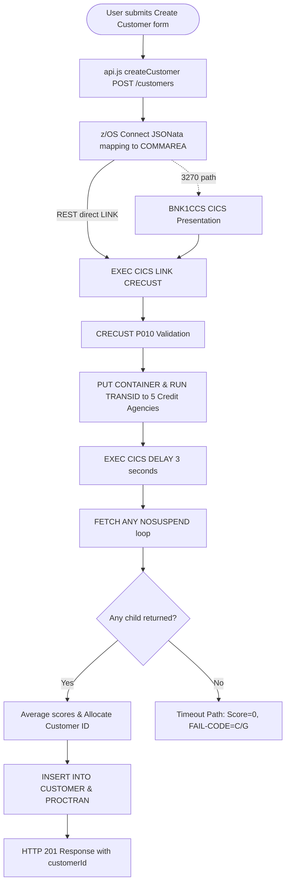

### Use Case 2: Multi-Language Program Explanation

**Description**: Explains the complete end-to-end transaction flow for customer creation across 5 technology layers (Browser JS, z/OS Connect API mapping, CICS presentation, COBOL business logic with asynchronous child tasks, and DB2 persistence), including timeout failure path tracing.

**Prompt**: Explain the complete end-to-end flow when a user creates a new customer in the Bank of Z web UI. Start from the JavaScript fetch call in api.js, trace through the z/OS Connect JSONata request mapping, into the CICS presentation program BNK1CCS.cbl, then CRECUST.cbl — including the asynchronous CICS child tasks it spawns to the five credit agency stubs, how it aggregates credit scores using CICS containers and RETRIEVE SUBEVENT, and finally how it writes to DB2. Explain what happens at each layer if all five credit agency child tasks time out before returning.

**Key Points (Why it matters)**:
- **Cross-language, cross-layer reasoning in one pass**: Synthesizes a unified narrative spanning JavaScript, OpenAPI/JSONata YAML, multiple COBOL programs, and DB2 SQL without context switching.
- **Project-level institutional knowledge**: Accurately accounts for project-specific rules and configurations (e.g., CICS transaction IDs, COMMAREA structures, customer routing rules) without hallucinating.
- **Precise error & failure path tracing**: Identifies exact divergence points, failure codes (`COMM-FAIL-CODE`), skipped execution paragraphs, and HTTP error mapping when asynchronous dependencies time out.
- **Grounded and auditable**: Directly cites source code lines across all relevant files without speculating.

**Demo Setup**:
- **Mode**: `Z Architect`
- **Active File / Context**: None
- **Prerequisites / Tooling**: Local workspace with access to project sources code

**Sample Output**:

### End-to-End Flow: Create New Customer

#### Layer 1 — Web UI: `createCustomer()` in `api.js`
The user submits the form on `customer-create.html`. The page calls `createCustomer(customerData)` in `api.js`:
```javascript
async createCustomer(customerData) {
    return this.request(`${this.configuration.baseUrl}/customers`, {
        method: 'POST',
        body: JSON.stringify(customerData)
    });
}
```
*Routing note:* Customer creation unconditionally targets `/customers` (CICS path) because no customer ID exists yet to trigger IMS prefix routing.

#### Layer 2 — z/OS Connect: Request Mapping
z/OS Connect applies JSONata mappings in `request.yaml` to transform the incoming JSON body into the `CRECUSTZ` CICS COMMAREA structure and invokes transaction `OMEN` bound to `CRECUST`.

#### Layer 3 — BNK1CCS: CICS Presentation Program (3270 Path)
When invoked via 3270 terminal (transid `OCCS`), `BNK1CCS.cbl` receives map `BNK1CCM`, disables uppercase translation (`SET TERMINAL ... NOUCTRAN`) to preserve casing, validates fields, and issues `EXEC CICS LINK PROGRAM('CRECUST') SYNCONRETURN`. *(Note: REST API calls bypass `BNK1CCS` directly to `CRECUST`).*

#### Layer 4 — CRECUST: Business Program & Asynchronous Credit Checks
1. **Validation & Timestamps**: Validates `COMM-TITLE` and DOB; fetches time/date via `EXEC CICS ASKTIME`/`FORMATTIME`.
2. **Async Child Tasks**: Spawns 5 asynchronous CICS child tasks (`CRDTAGY1` to `CRDTAGY5`) via `EXEC CICS PUT CONTAINER` and `EXEC CICS RUN TRANSID`.
3. **Wait & Retrieval**: Issues `EXEC CICS DELAY FOR SECONDS(3)` and loops through `EXEC CICS FETCH ANY NOSUSPEND` to collect responses.
4. **Number Allocation & DB2 Persistence**: Acquires named counter lock (`ENQ 'BNKCUSTS' + sortcode`), allocates next customer ID from `STTESTER.CONTROL`, and executes `EXEC SQL INSERT INTO CUSTOMER` followed by an audit write to `PROCTRAN` (`type 'OCC'`).

#### Complete Flow Diagram


#### What Happens When All Five Credit Agencies Time Out
If `WS-RETRIEVED-CNT = 0` after 3 seconds:
- **CRECUST**: Sets `COMM-SUCCESS = 'N'`, `COMM-FAIL-CODE = 'G'`, score = 0, review date = today. Bypasses customer number allocation and DB2 `CUSTOMER`/`PROCTRAN` INSERTs entirely.
- **z/OS Connect**: Maps failure flag to HTTP 400 Bad Request.
- **Web UI**: Catches non-200 response and surfaces an error notification to the user.
- **Orphaned Child Tasks**: Any credit agency tasks finishing after parent termination are safely discarded by CICS without impacting transaction integrity.
